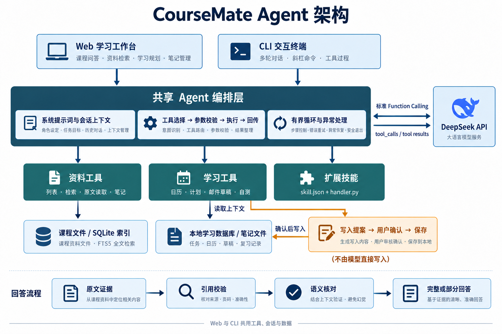

# CourseMate 学习助手

CourseMate 把课程资料、学习计划和复习记录放在同一个工作台里。导入课件后，可以让它总结内容、解释概念、引用原文并整理笔记，也可以根据本地日历安排学习时间、起草邮件或生成自测题。

项目提供网页工作台和交互式 CLI，两种界面共用 Agent、工具和本地数据。

仓库：https://github.com/pikaka007/course_agent

## 快速开始

需要 Python 3.10 或更高版本，并支持 SQLite FTS5。在项目目录使用以下命令：

```powershell
git clone https://github.com/pikaka007/course_agent.git
cd course_agent
python -m pip install -r requirements-lock.txt
python app.py check
python app.py serve --port 8765
```

打开 http://127.0.0.1:8765，在“设置”中填写模型接口、模型名称和 API Key，然后测试连接。DeepSeek 官方接口地址为 `https://api.deepseek.com`；模型名称请以自己的账户实际可用列表为准。

也可以复制 `.env.example` 为 `.env` 后填写配置。项目优先读取本地 `.env`，其次读取系统环境变量。密钥只保存在本机，配置示例和源码包不包含实际密钥。网页修改连接后，已打开的 CLI 需要重启才能读取新配置。

以下命令统一使用 `python`。如果系统使用 `python3`，替换命令名即可；安装依赖和运行项目时请使用同一个 Python。可选的依赖隔离方式见 [安装说明](docs/installation.md)。

完整操作步骤、工具执行过程及异常处理见 [Agent 运行说明](docs/runtime-guide.md)。

## 网页怎么用

先在“资料库”导入 PDF、PPTX、DOCX、TXT 或 Markdown，再到“学习对话”选择资料并提问，例如：“总结这份课件，按主题列出要点并引用原文。”回答旁可以查看工具过程和来源；如果有多份同类资料而问题不明确，助手会先让你选文件。

其他功能分别放在独立页面：

- **任务与计划**：手动维护任务、导入本地 ICS 日历、寻找空闲时间并预览学习安排。
- **邮件草稿**：根据需求起草邮件，编辑后复制或导出为 `.eml`。
- **复习自测**：依据课程原文出题，回答后查看参考答案，再记录掌握程度。
- **设置**：调整回答偏好、模型连接和任务模板，管理扩展技能。

涉及任务、日程、草稿和自测记录的模型写操作先生成预览，确认后才保存。

## 交互式 CLI

在项目目录运行以下命令，或双击 `终端聊天.bat`：

```powershell
python app.py chat
```

进入后可以连续提问，不必每次重新启动程序。终端支持 Markdown 输出、工具执行进度、输入历史、命令补全和会话恢复。Enter 发送，Esc+Enter 换行，Tab 补全命令，Ctrl+C 可中断正在接收的回答。

下面是一组操作示例；把文件名换成自己导入的资料：

```text
/docs
/use Vibe Coding(1).pptx
总结这份课件，说明 Agent 如何调用工具。
/sources
/trace
```

| 想做什么 | 命令 |
| --- | --- |
| 查看完整帮助 | `/help` |
| 导入资料、选择范围 | `/import 路径`、`/use 文件名` |
| 新建或恢复会话 | `/new`、`/sessions`、`/resume 编号` |
| 查看引用与核对结果 | `/sources`、`/review` |
| 查看工具调用 | `/trace` |
| 查看并处理写入预览 | `/pending`、`/confirm 编号`、`/reject 编号` |
| 查看学习记录、导入日历 | `/study`、`/calendar ICS路径` |
| 配置并测试模型 | `/config`、`/models`、`/test` |
| 退出 | `/quit` |

网页和 CLI 可以恢复同一份本地会话，请避免同时修改同一个会话。CLI 面向学习任务，不提供任意 Shell 执行或代码编辑。管道环境可使用 `app.py chat --plain`；脚本调用可使用 `app.py run "你的问题"`。

## Agent 如何工作



用户问题、系统提示词和会话上下文进入共享编排层。模型通过标准 Function Calling 返回工具名称和 JSON 参数；程序校验参数后执行工具，再把结果按 `tool_call_id` 回传。模型可以继续选择工具，直到形成答案或达到执行上限。

资料检索使用 SQLite FTS5，读取工具返回原文与页码、幻灯片编号或行号。回答经过引用检查和原文证据核对；部分段落无法核实时，系统会明确标注部分回答，保留可以核对的内容。核对仍可能误判，重要内容应查看原文。

| 模块 | 职责 |
| --- | --- |
| `course_agent/agent.py` | 模型与工具之间的编排循环 |
| `course_agent/provider.py` | 模型接口请求与连通性测试 |
| `course_agent/tools.py` | 资料列表、检索、读取和笔记保存 |
| `course_agent/plugins.py` | 技能发现、参数协议和扩展工具执行 |
| `course_agent/life.py` | 任务、日历、草稿、自测与确认事务 |
| `course_agent/citations.py`、`evidence.py` | 引用和证据核对 |
| `course_agent/server.py`、`web/` | 本地网页服务与界面 |
| `course_agent/terminal.py` | 交互式 CLI |
| `prompts/system.md` | Agent 的系统提示词 |

项目采用作业允许的标准函数调用方案，未实现 MCP Server。Codex 编写了接口请求、参数 Schema、工具注册和编排等代码；项目设计围绕提示词、工具能力和用户操作流程展开。

## 扩展技能

内置技能位于 `skills/`。第三方技能需要符合本项目的 `skill.json` 与 `handler.py` 协议，不能把任意下载的 `SKILL.md` 直接当成可执行插件。

安装后的技能默认停用。查看源码和依赖并启用后，Agent 才能调用；文件内容变化会使原有授权失效。Python 插件以当前用户权限运行，请只启用可信代码。

编写方式见 [技能开发指南](docs/skill-authoring.md)，可参考 `examples/focus_minutes/`。

## 数据在哪里

| 目录 | 内容 |
| --- | --- |
| `data/` | 导入的课程资料 |
| `outputs/` | 保存的 Markdown 笔记 |
| `local/` | 索引、会话、学习记录、已安装技能等本地状态 |
| `logs/` | 回答、工具调用和核对记录 |
| `evidence/` | 本机验收记录与截图 |

这些目录中的运行数据以及 `.env` 已通过忽略规则排除，仓库只保留必要的说明和占位文件。分享源码建议运行 `python scripts/export_source.py`，生成的 `release/CourseMate-source.zip` 使用文件白名单打包，不包含本地资料、日志或密钥。Git 忽略规则不会自动移除已经跟踪的文件，提交前仍应查看暂存区。

真实模式会把问题和相关工具上下文发送给配置的模型平台。本地保存数据并不等于离线处理。

## 验证与使用范围

```powershell
python -m unittest discover -s tests -v
```

现有回归记录为 105 项测试通过，覆盖资料处理、引用检查、会话、技能和确认事务。真实 API 验收记录与离线测试分别保存；`python scripts/live_study_acceptance.py --live` 会产生实际模型用量。`demo` 是固定演示流程，不调用模型；真实请求失败不会自动伪装成演示成功。

目前使用本地日历和邮件草稿，不连接在线邮箱，也不发送邮件。PDF 需要包含可提取文字，未集成 OCR；重复日历事件需要先展开。复习提醒在打开或刷新页面时检查，不是后台推送服务。

