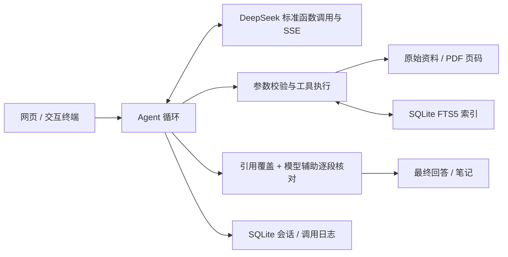

# 第四版架构

网页和 Rich/prompt-toolkit 终端共用 agent.run_agent。配置从本机 .env 优先加载；最近六轮有效对话帮助理解追问，每轮仍需检索新证据。

streaming.py 将 SSE 分片组装成完整工具调用；后台读取线程避免取消时阻塞前台。server.py 保存累积草稿供轮询，最终核对结果覆盖草稿。evidence.py 检查审核覆盖、来源归属与逐字摘录；不等于独立事实核查。

sessions.py 使用 SQLite 事务和一次性 JSON 迁移；workspace.py 管理偏好、资料回收站、导出、删除与归档。retrieval.py 持久化全文原文和 FTS5 tokens，按修改时间和大小更新。pdf_text.py 在子进程中解析文字型 PDF，保持真实页码；没有 OCR。

服务器只监听 127.0.0.1，写请求校验随机令牌、Host 和 Origin。HTML 使用文本节点，终端清理控制字符。密钥、原文、日志、数据库、证据副本均默认不入 Git；源码包从白名单导出并扫描密钥。具体数据路径、限制与真实验收见 iteration-v4.md。
